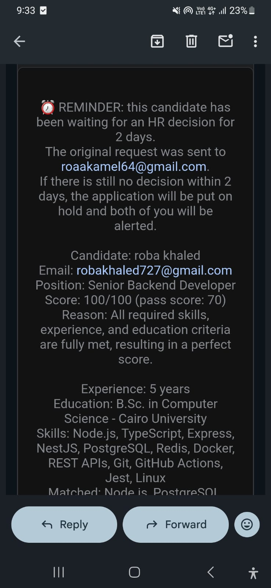
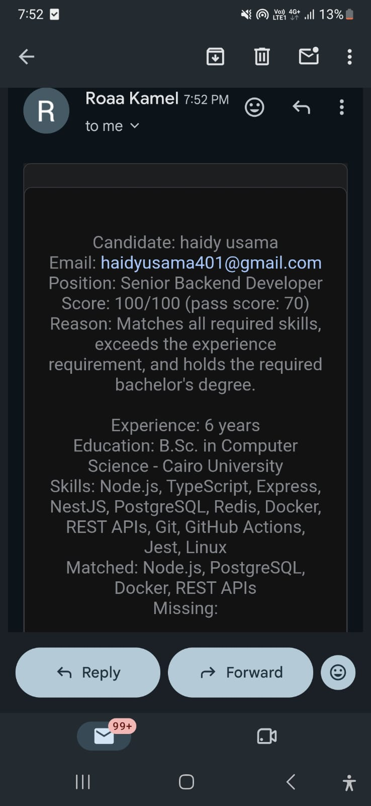
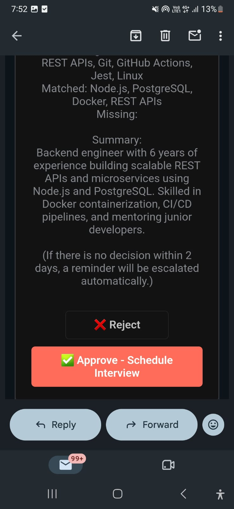
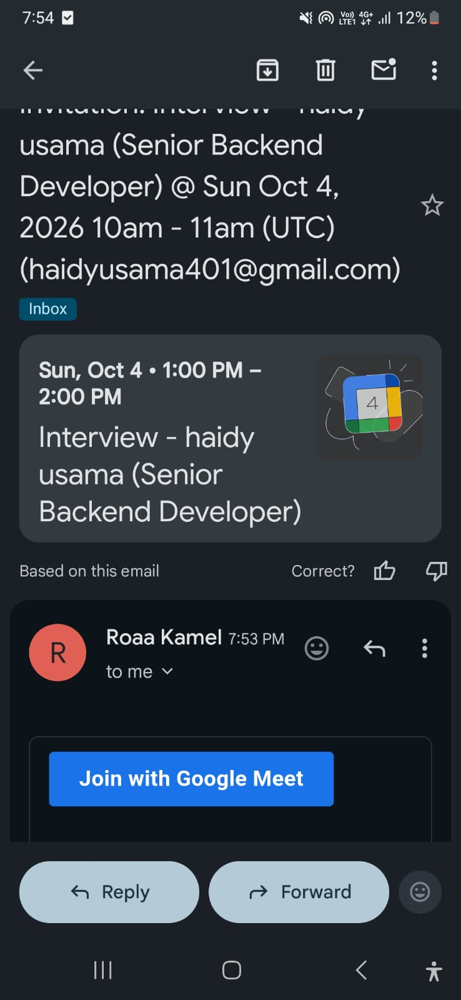
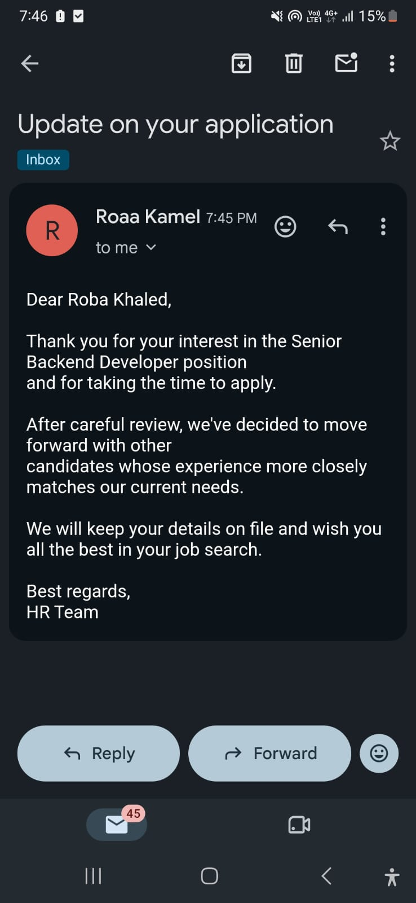

# 🤖 HR CV Screening & Recruitment Automation System

An AI-powered HR recruitment automation system designed to streamline the hiring process, automate CV screening, and improve communication between candidates and HR teams.

Built using **n8n and AI**, the system helps reduce manual recruitment tasks and organize candidate evaluation through an automated workflow.

---

## 📌 Project Overview

Recruitment processes often involve repetitive manual tasks, including reviewing CVs, evaluating candidates, managing applications, and coordinating interviews.

This project aims to automate key stages of the recruitment process through an AI-powered workflow that supports HR teams in handling candidate applications more efficiently.

## ✨ Key Features

- **Automated Application Handling:** Receives and processes candidate applications.
- **AI-Powered CV Screening:** Uses AI to assist in evaluating candidate CVs.
- **Candidate Evaluation:** Supports the candidate screening and selection process.
- **HR Approval Workflow:** Includes an HR approval stage in the recruitment process.
- **Automated Notifications:** Sends notifications as part of the workflow.
- **Follow-up & Escalation:** Includes an alert mechanism when an expected response is not received.
- **Interview Coordination:** Supports the interview stage of the recruitment workflow.
- **Rejection Handling:** Includes a rejection stage for unsuccessful applications.

## ⚙️ Workflow Overview

The recruitment automation process is organized into the following stages:

1. **Application Submission:** The candidate submits an application through the application form.
2. **CV Screening:** The submitted CV is processed and evaluated using AI.
3. **HR Review & Approval:** The evaluation proceeds through an HR review and approval stage.
4. **Notifications & Follow-up:** Automated notifications are triggered, with an escalation alert when a response is delayed.
5. **Interview Stage:** Candidates who proceed in the recruitment process move to the interview stage.
6. **Rejection Stage:** Applications that do not proceed are handled through the rejection process.

## 🛠️ Technologies Used

- **n8n:** Workflow automation and orchestration.
- **Artificial Intelligence (AI):** AI-powered CV screening and candidate evaluation.
- **JSON:** Workflow configuration and export.

## 📸 Project Screenshots

### 1. HR Recruitment Workflow

### 2. Application & Screening Process

### 3. Automated Alert Notification

### 4. HR Approval

### 5. Interview Stage

### 6. Rejection Notification

## 📂 Project Files

| File / Folder | Description |
|---|---|
| `HR_CV_Screening_Document.pdf` | Project documentation |
| `HR_Workflow.json` | Exported n8n workflow |
| `imgs/` | Project screenshots and workflow visuals |

## 🚀 Getting Started

To explore the project:

1. Clone or download this repository.
2. Import `HR_Workflow.json` into your n8n instance.
3. Configure the required credentials and integrations.
4. Set up the necessary AI model and services.
5. Configure the workflow according to your environment.
6. Test the workflow using sample candidate applications.

**Note:** Credentials, API keys, and external service configurations may need to be added before running the workflow.

## 🎯 Project Goal

The goal of this project is to demonstrate how AI and workflow automation can be combined to improve recruitment operations, reduce repetitive HR tasks, and create a more structured candidate screening process.

---

**Developed by:** Roaa Khaled

[GitHub Repository](https://github.com/Roaakhaled412/HR-CV-Screening)
